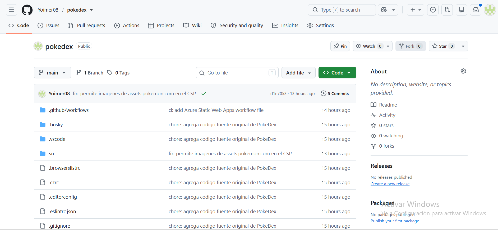
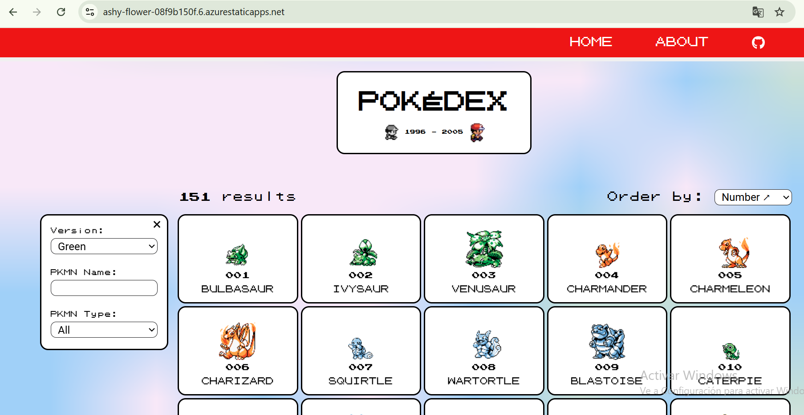
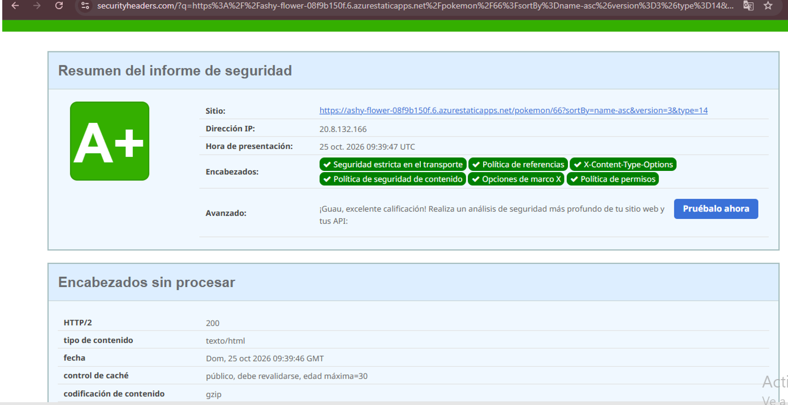
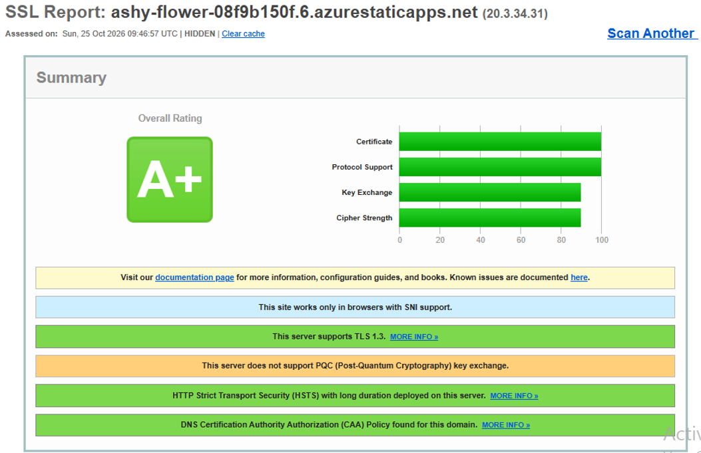

# Despliegue de PokeDex en Azure Static Web Apps

Este documento explica **cómo se publicó la aplicación PokeDex** (Angular 14) en Azure, paso a paso y con los comandos usados. La creación de la cuenta está en el [README.md](README.md).

- **Entorno:** Windows 11, Git 2.56, Node.js 16.20.2, npm 8.19.4, Visual Studio Code.
- **URL pública:** https://ashy-flower-08f9b150f.6.azurestaticapps.net/

## Cómo funciona (resumen)

```
Mi PC ──git push──► GitHub (repo pokedex) ──GitHub Actions──► Azure Static Web Apps ──► Internet (HTTPS)
```

Angular se **compila** a archivos estáticos (HTML, JS, CSS) en `dist/pokedex-angular`. Azure solo los sirve, y no se necesita servidor propio. Cada `git push` a `main` dispara una compilación y publicación automáticas (CI/CD).

---

## 1. Requisitos

| Herramienta | Versión usada | Para qué |
|---|---|---|
| Git | 2.56 | Subir el código a GitHub |
| Node.js | **16.20.2** | Compilar Angular 14 (soporta Node 14 y 16) |
| npm | 8.19.4 | Instalar dependencias |
| Cuenta de GitHub | `Yoimer08` | Repositorio y CI/CD |
| Cuenta de Azure for Students | | Hospedaje |

Verificación:

```
node -v
npm -v
git --version
```

## 2. Configurar Git

```
git config --global user.name "Yoimer08"
git config --global user.email "<Yoimernunezc>"
git config --global --list
```

Al instalar Git se cambió el editor predeterminado a Visual Studio Code y la rama inicial a `main`.

## 3. Crear el repositorio `pokedex` y clonarlo

1. En GitHub: **New repository** → nombre `pokedex`, visibilidad **Public**, con README → **Create repository**.
2. Clonarlo:

```
cd %USERPROFILE%\Documents
git clone https://github.com/Yoimer08/pokedex.git
```



## 4. Copiar el código fuente

El código se descargó del material de la asignación (`pokedex-angular.zip`) y se copió dentro del repositorio, **sin** la carpeta `node_modules`:

```
robocopy "<ruta>\pokedex-angular" "%USERPROFILE%\Documents\pokedex" /E /XD node_modules
```

## 5. Primer commit (punto de restauración)

```
cd "%USERPROFILE%\Documents\pokedex"
git add .
git commit -m "chore: agrega codigo fuente original de PokeDex"
git push origin main
```

Guardar el código original antes de modificarlo permite volver a este punto y ver con claridad qué se cambió.

## 6. Instalar dependencias

```
npm install --ignore-scripts
```

Se usa `--ignore-scripts` para no activar **Husky**, una herramienta del autor original que se engancha a cada commit y que aquí no hace falta.

## 7. Adaptar el código a Azure

El proyecto original estaba hecho para GitHub Pages. Se hicieron estos cambios:

| Archivo | Cambio | Motivo |
|---|---|---|
| `src/environments/environment.prod.ts` | `imagesPath` de `/pokedex-angular/assets/images` a `/assets/images` | Con la ruta original las imágenes no cargan en otra URL. |
| `src/index.html` | Se eliminó el `<script>` de redirección de GitHub Pages | Ese script inline impide un CSP seguro y Azure lo reemplaza con `navigationFallback`. |
| `src/404.html` | Eliminado (y quitado de `angular.json`) | Es un parche exclusivo de GitHub Pages. |
| `src/assets/styles/base/_typography.scss` | Se quitó el `@import` de Google Fonts | Se aloja la fuente Roboto localmente. |
| `package.json` | Se agregó `@fontsource/roboto`; se quitaron los scripts `predeploy`, `deploy` y `prepare` | Fuente local; scripts de GitHub Pages y Husky no se usan. |
| `angular.json` | Se agregó el CSS de Roboto a `styles`, `inlineCritical: false` y `staticwebapp.config.json` a `assets` | Evita un `onload=` inline que el CSP bloquearía y copia la configuración al build. |
| `.github/workflows/pipelines.yml` | Eliminado | Ejecutaba pruebas y Codecov del autor original. |
| `src/staticwebapp.config.json` | **Nuevo** | Encabezados de seguridad y reglas de rutas. |

Instalación de la fuente local:

```
npm install --ignore-scripts @fontsource/roboto
```

### Compilar y comprobar en local

```
npm run build
```

Resultado esperado: la carpeta `dist/pokedex-angular` con `index.html`, los `.js`, `.css`, las fuentes de Roboto y `staticwebapp.config.json`. Salen dos advertencias de tamaño (*budgets*). Son normales y no son errores.

Se comprobó antes de subir, con un navegador real, que el CSP no bloqueara recursos.

### Subir los cambios

```
git add .
git commit -m "feat: adapta PokeDex para Azure Static Web Apps y agrega encabezados de seguridad"
git push origin main
```


## 8. Crear la Static Web App en Azure

Pasos detallados y capturas en el [README.md](README.md#paso-5-crear-la-aplicación-web-estática). Datos clave:

| Campo | Valor |
|---|---|
| Grupo de recursos | `rg-pokedex` |
| Nombre | `pokedex-yoimer-nunez` |
| Plan | Free |
| Origen | GitHub → `Yoimer08/pokedex`, rama `main` |
| Ubicación de la aplicación | `/` |
| Ubicación de la API | *(vacío)* |
| Ubicación de salida | `dist/pokedex-angular` |
| Región | East US 2 |

**Problema encontrado:** la región `Central US` fue rechazada con `RequestDisallowedByAzure`, porque la suscripción de estudiante restringe regiones. Se resolvió eligiendo **East US 2**.

Al crear el recurso, Azure:

1. Agregó al repo el workflow `.github/workflows/azure-static-web-apps-ashy-flower-08f9b150f.yml`.
2. Guardó el token de despliegue como secreto del repositorio.
3. Ejecutó la primera compilación, que terminó en verde (✓).

Después hay que traer ese commit a la PC antes de seguir trabajando, o el siguiente `push` será rechazado:

```
git pull origin main
```

## 9. Verificar la aplicación en línea

1. Abrir la URL pública.
2. Comprobar: lista de 151 Pokémon, filtros por nombre y tipo, y detalle de un Pokémon.
3. Recargar con `F5` estando dentro de un detalle. Debe seguir funcionando (el `navigationFallback` devuelve `index.html`).
4. Abrir `F12` → **Console** y revisar que no haya errores de CSP.

**Problema encontrado:** la imagen grande del detalle no cargaba. La consola mostró:

```
Loading the image 'https://assets.pokemon.com/assets/cms2/img/pokedex/full/002.png'
violates the following Content Security Policy directive: "img-src 'self' data:".
```

La dirección de esa imagen llega dentro de los datos de la API, por eso no aparecía al revisar el código. **Solución:** autorizar únicamente ese dominio en `img-src`:

```
img-src 'self' data: https://assets.pokemon.com;
```

```
git add .
git commit -m "fix: permite imagenes de assets.pokemon.com en el CSP"
git push origin main
```

Azure republicó solo en unos 2 minutos y la imagen cargó.



---

## Encabezados de seguridad

Se definen en `src/staticwebapp.config.json`, dentro de `globalHeaders`.

| Encabezado | Valor | Qué protege |
|---|---|---|
| `Content-Security-Policy` | Solo recursos propios más `pokeapi.co`, `beta.pokeapi.co` y `assets.pokemon.com` | Mitiga XSS: el navegador bloquea scripts o recursos no autorizados. |
| `Strict-Transport-Security` | `max-age=31536000; includeSubDomains` | Obliga a usar HTTPS durante un año. |
| `X-Frame-Options` | `DENY` | Impide que otro sitio meta la página en un iframe (clickjacking). |
| `X-Content-Type-Options` | `nosniff` | El navegador no adivina el tipo de archivo. |
| `Referrer-Policy` | `strict-origin-when-cross-origin` | Limita la información de origen enviada a otros sitios. |
| `Permissions-Policy` | cámara, micrófono, geolocalización, etc. desactivados | La app no los usa, así que se apagan. |
| `Cross-Origin-Opener-Policy` | `same-origin` | Aísla el contexto de navegación. |
| `Cross-Origin-Resource-Policy` | `same-origin` | Evita que otros orígenes carguen nuestros recursos. |

Azure agrega además, por defecto, `X-XSS-Protection` y `X-DNS-Prefetch-Control`.

### Política CSP en detalle

```
default-src 'none';
script-src 'self';
style-src 'self' 'unsafe-inline';
img-src 'self' data: https://assets.pokemon.com;
font-src 'self';
connect-src 'self' https://pokeapi.co https://beta.pokeapi.co;
base-uri 'self';
form-action 'self';
frame-ancestors 'none';
object-src 'none';
manifest-src 'self';
upgrade-insecure-requests
```

Se parte de `default-src 'none'` (no se permite nada) y se habilita solo lo necesario. `'unsafe-inline'` aparece únicamente en estilos, porque Angular los aplica de forma dinámica. **No** se permite en scripts.

### Rutas (SPA)

```json
"navigationFallback": {
  "rewrite": "/index.html",
  "exclude": ["/assets/*", "/*.{css,js,ico,png,jpg,gif,svg,woff,woff2,ttf,otf,eot,map,json,txt}"]
}
```

Cualquier ruta que no sea un archivo devuelve `index.html`, y Angular se encarga de mostrar la vista correcta.

---

## 10. Escaneos de seguridad

### securityheaders.com → **A+**

1. Abrir <https://securityheaders.com/>.
2. Pegar la URL pública, marcar *Follow redirects* y pulsar **Scan**.



### SSL Labs → **A+** (auditoría adicional)

1. Abrir <https://www.ssllabs.com/ssltest/>.
2. Escribir solo el dominio `ashy-flower-08f9b150f.6.azurestaticapps.net`, marcar *Do not show the results on the boards* y pulsar **Submit**.

Resultados destacados: TLS 1.3 soportado, HSTS con larga duración, certificado válido de Microsoft con Certificate Transparency y política CAA presente.



---

## 11. Cómo volver a desplegar

Con el CI/CD configurado basta con:

```
git add .
git commit -m "tipo: descripcion del cambio"
git push origin main
```

El avance se ve en GitHub, pestaña **Actions**. Cuando queda en verde, el cambio ya está publicado.

## 12. Solución de problemas

| Síntoma | Causa probable | Solución |
|---|---|---|
| `RequestDisallowedByAzure` al crear el recurso | Región no permitida en la suscripción de estudiante | Elegir otra región (funcionó East US 2). |
| Imagen o recurso no carga y la consola dice *violates Content Security Policy* | El CSP no incluye el origen | Agregar **solo** ese dominio a la directiva correspondiente. |
| `git push` rechazado (`fetch first`) | Azure agregó un commit al repo | `git pull origin main` y repetir el push. |
| Página en blanco al recargar una ruta | Falta el `navigationFallback` | Revisar `staticwebapp.config.json`. |
| La compilación en Actions falla | Versión de Node o ruta de salida incorrecta | Revisar el log y que la ubicación de salida sea `dist/pokedex-angular`. |
| Cambios que no se ven | Caché del navegador | `Ctrl + F5`. |


