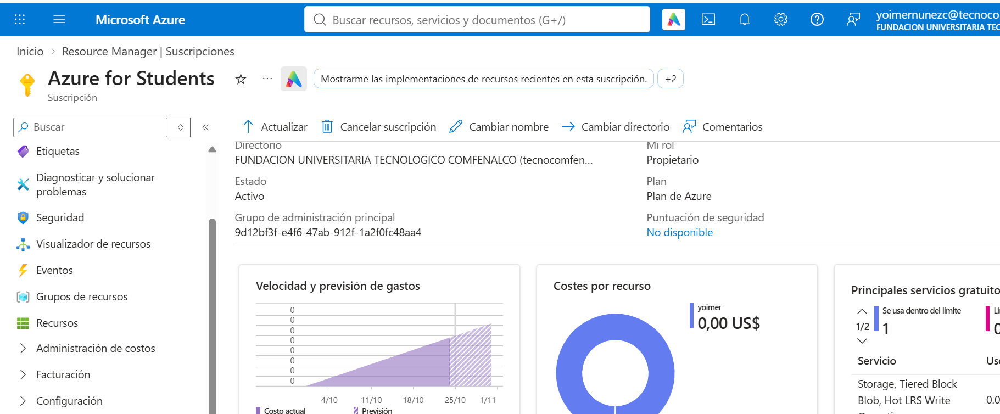
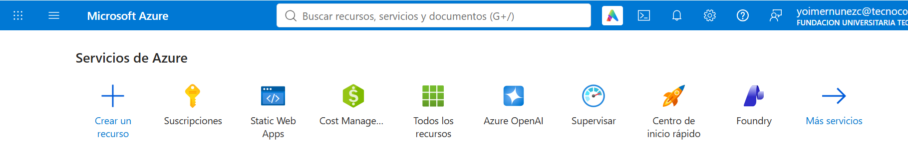
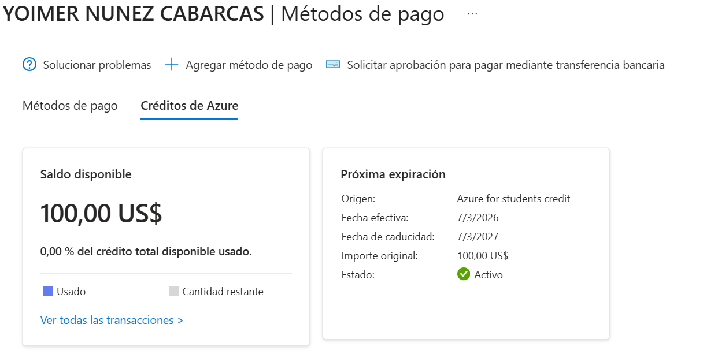
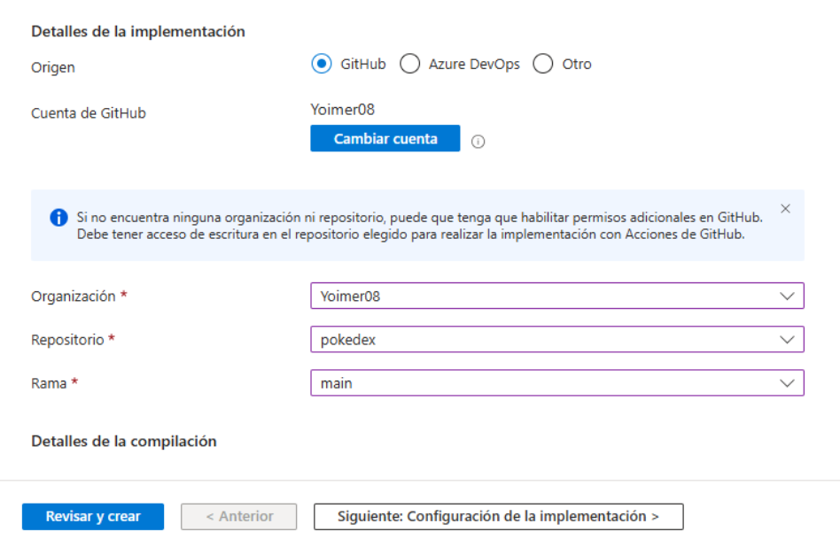
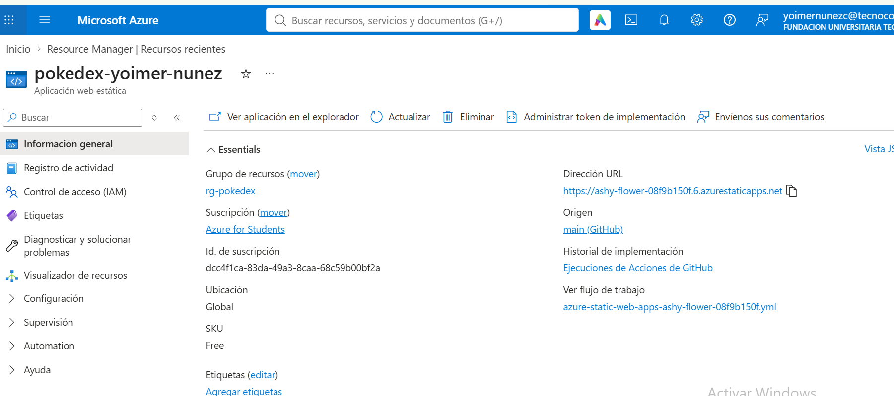
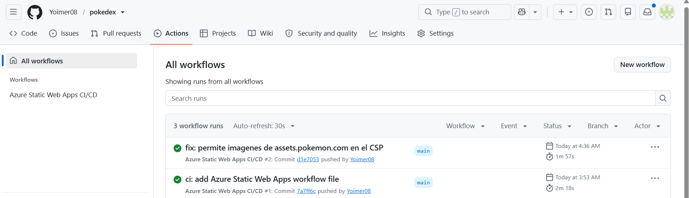
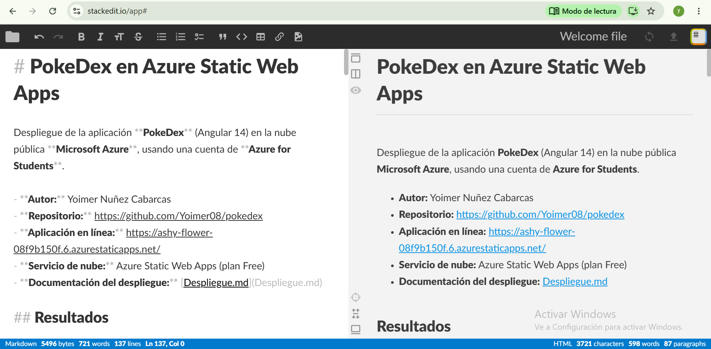
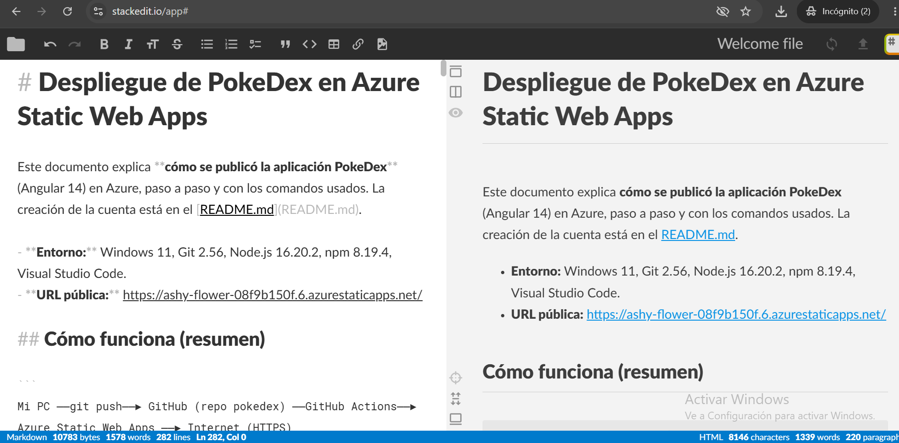

# PokeDex en Azure Static Web Apps

Despliegue de la aplicación **PokeDex** (Angular 14) en la nube pública **Microsoft Azure**, usando una cuenta de **Azure for Students**.

- **Autor:** Yoimer Nuñez Cabarcas
- **Repositorio:** https://github.com/Yoimer08/pokedex
- **Aplicación en línea:** https://ashy-flower-08f9b150f.6.azurestaticapps.net/
- **Servicio de nube:** Azure Static Web Apps (plan Free)
- **Documentación del despliegue:** [Despliegue.md](Despliegue.md)

## Resultados

| Verificación | Herramienta | Resultado |
|---|---|---|
| Encabezados de seguridad | [securityheaders.com](https://securityheaders.com/) | **A+** |
| Cifrado HTTPS | [SSL Labs](https://www.ssllabs.com/ssltest/) | **A+** |

Fecha de los escaneos: 25 de octubre de 2026.

---

## Tutorial: cuenta en la nube pública (Azure for Students)

### ¿Por qué Azure for Students?

La actividad permite varias nubes. Elegí Azure for Students por estas razones:

- Ya cuento con la cuenta institucional, así que no necesito tarjeta de crédito.
- Incluye **US$100 de crédito**, de los cuales este proyecto no consume nada porque usa el plan gratuito.
- **Azure Static Web Apps** está pensado para aplicaciones de una sola página como Angular. Da HTTPS automático, despliegue continuo desde GitHub y permite configurar encabezados de seguridad en un solo archivo.

### Paso 1. Disponer de la cuenta institucional

Mi cuenta de Azure for Students está asociada a mi correo institucional de la Fundación Universitaria Tecnológico Comfenalco (`@tecnocomfenalco.edu.co`). Esta cuenta la registré en un semestre anterior y quedó activa, por lo que en esta actividad **solo fue necesario volver a iniciar sesión**.




### Paso 2. Iniciar sesión en el portal

1. Abrir <https://portal.azure.com>.
2. Iniciar sesión con el correo institucional.
3. Completar la autenticación que solicite la institución.



### Paso 3. Comprobar la suscripción y el crédito

1. En el buscador del portal escribir **Suscripciones**.
2. Confirmar que aparece **Azure for Students** y que está activa.
3. Verificar el saldo disponible: **US$100,00** (origen: *Azure for Students credit*).



### Paso 4. Restricción de regiones de la suscripción (hallazgo importante)

Las suscripciones de estudiante tienen una **política que limita en qué regiones se pueden crear recursos**. Al crear la aplicación en `Central US` el despliegue falló con este mensaje:

```
RequestDisallowedByAzure: This policy maintains a set of best available regions
where your subscription can deploy resources.
```

**Solución:** repetir la creación eligiendo otra región. Funcionó **East US 2**.


### Paso 5. Crear la aplicación web estática

1. Buscar **Static Web Apps** en el portal y pulsar **Crear**.
2. Completar el formulario:

| Campo | Valor |
|---|---|
| Suscripción | Azure for Students |
| Grupo de recursos | `rg-pokedex` (nuevo) |
| Nombre | `pokedex-yoimer-nunez` |
| Tipo de plan | Gratis (Free) |
| Origen | GitHub (cuenta `Yoimer08`) |
| Repositorio / rama | `pokedex` / `main` |
| Preestablecido de compilación | Angular |
| Ubicación de la aplicación | `/` |
| Ubicación de la API | *(vacío)* |
| Ubicación de salida | `dist/pokedex-angular` |
| Región | East US 2 |

3. Pulsar **Revisar y crear** y luego **Crear**.



### Paso 6. Verificar el recurso y la URL pública

Al terminar, en **Información general** del recurso aparece la dirección pública:

`https://ashy-flower-08f9b150f.6.azurestaticapps.net/`



Azure también agregó automáticamente al repositorio un archivo de **GitHub Actions** (`.github/workflows/azure-static-web-apps-ashy-flower-08f9b150f.yml`) y un secreto con el token de despliegue. A partir de ahí, **cada `git push` a `main` publica la aplicación automáticamente**.



El paso a paso técnico del despliegue está en [Despliegue.md](Despliegue.md).

---

## Seguridad

Los encabezados HTTP de seguridad se definen en `src/staticwebapp.config.json`. Ahí se explica cada uno: [Despliegue.md](Despliegue.md#encabezados-de-seguridad).


---




---


## Estructura relevante del repositorio

```
pokedex/
├── .github/workflows/azure-static-web-apps-ashy-flower-08f9b150f.yml   # CI/CD generado por Azure
├── capturas/                                       # evidencias de este documento
├── src/staticwebapp.config.json                    # encabezados de seguridad y fallback de rutas
├── angular.json
├── package.json
├── README.md
└── Despliegue.md
```

## Limitaciones conocidas

- `npm install` informa **vulnerabilidades en dependencias de desarrollo** (herramientas de compilación y pruebas de Angular 14, una versión antigua). No forman parte de los archivos publicados. No se ejecutó `npm audit fix --force`, porque rompería el proyecto.
- La política de seguridad (CSP) permite `'unsafe-inline'` en `style-src`, porque Angular aplica estilos dinámicos. No hay `unsafe-inline` en `script-src`.
- La aplicación depende de servicios externos: PokéAPI (datos) y `assets.pokemon.com` (imagen grande del detalle).


